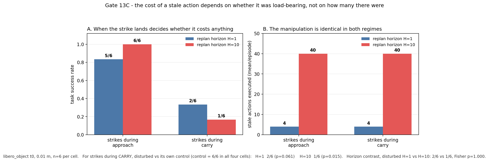
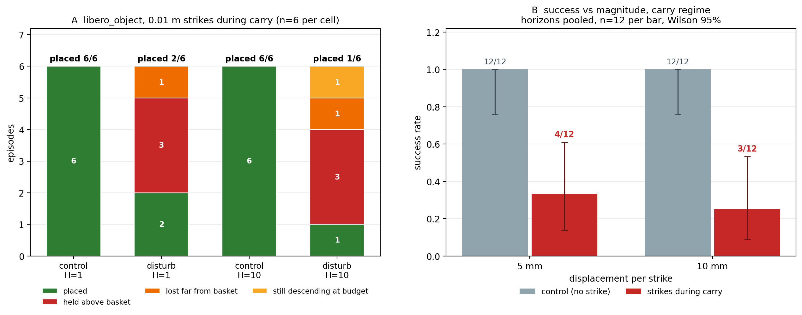
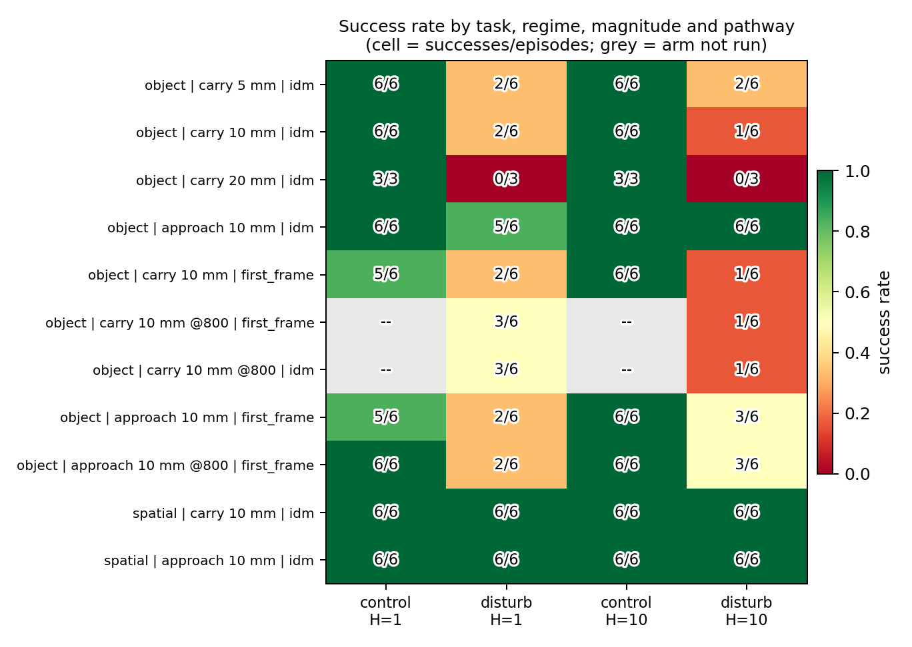
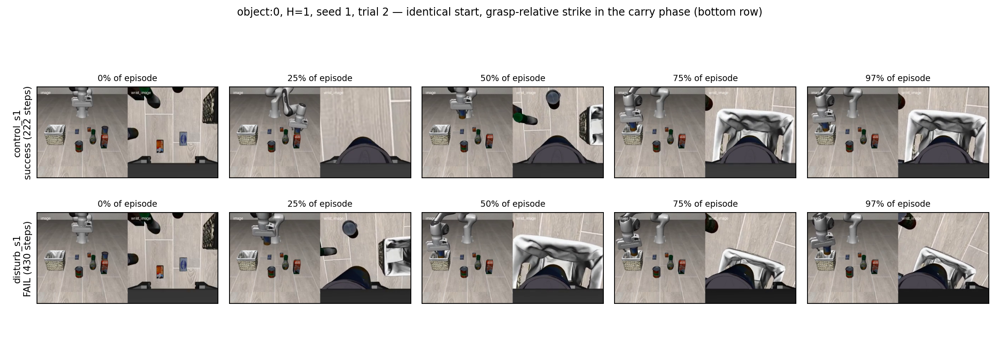

# fastwam_bench

A controlled-intervention harness for measuring the **world-modeling commitment** of a World Action
Model (WAM). The target model is **FastWAM**; the environment is **LIBERO-Safety**.

The core question this repo answers: *when the world changes underneath a World Action Model, does the
model behave like one — i.e. does its risk/planning actually depend on the world state — or does it just
execute an open-loop action chunk?*

## Bottom line (read this first)

Every gate below (A–D, 7–14) is reproducible from this repo:

- **A single mid-chunk world displacement is harmless where the stale actions are not load-bearing.**
  In the approach phase it costs nothing measurable: 12/12 vs 11/12 (Fisher p=1.0), twice replicated.
- **The same displacement is destructive where they are load-bearing.** Moved into the carry phase it
  takes success from 6/6 to 2/6 (H=1) and 1/6 (H=10); pooled over horizon 3/12 vs 12/12, p=0.0003.
- **But the damage does not scale with the commitment horizon** — the number of stale actions — in
  either regime (three independent replications, H=1 vs H=10 p=1.000 in the carry regime).
- **The mechanism is not mechanical and not a reach failure.** The grasp is never broken: **54/54**
  struck episodes across both pathways lift the object, and in **9 of 23** future-aware failures it is
  never released at all. The policy carries the object to the basket and parks it 5.5–9.9 cm above the
  placement height, or carries it away entirely.
- **Magnitude is a weak lever.** 5 → 20 mm changes nothing resolvable (success 33% → 25% → 0%, all
  pairwise contrasts p ≥ 0.245), whereas *when* the strike lands flips the result from null to large.
- **And stale execution is not the channel at all** (Gate 14E). Strike *before* the query, refresh
  the observation so the chunk is planned against the mutated world, and the episode is still
  **2/6** — with 0 stale actions instead of 10. The refresh is measured, not assumed: 5.3% of pixels
  changed at the strike. All three arms (10, 1, 0 stale actions) agree **episode for episode**,
  down to the step count.

So the honest summary is much narrower than earlier versions of this file claimed. **A world
displacement costs success in the carry phase, and the cost is not carried by already-planned
actions.** Reducing stale execution from 10 to 0 — verified to change what the model sees — leaves
the outcome identical. Both "replaying a chunk planned against a world that no longer exists" and
"the fixed-horizon chunk execution" framing are **retired**: the episode fails whether the chunk is
replayed, truncated, or never replayed.

That takes the explanation away from the horizon gradient as well. Four strikes cost more than one
(1/6 vs 2/6 at H=10), but one strike at H=10 costs the same as the four-strike H=1 cell (2/6), and
stale-action count — the obvious candidate — is inert. The gradient is real and measured; its
mechanism is **unexplained**, and it should not be restated as "commitment compounds with horizon".

**What does explain the cost is a corrective response that grows far too slowly** (Gate 14G). Sweeping
the displacement from 2 mm to 40 mm with one strike, n=9 per magnitude: success falls 9/9 → 8/9 → 4/9
→ 1/9 → **1/9** (rho = −0.975; 2 vs 40 mm p=4.1e-4), while the policy's mean change of plan grows as
roughly **m^0.22** — 20× the displacement buys **2.1×** the response. The model responds; the response
is far shallower than the damage.

**And the shortfall is specifically in the placement, not the approach** (Gate 14H). Measuring the
object itself from the same records: successful episodes end at a **fixed** height — 0.114–0.128 m
across a 20× magnitude change, against control's 0.1126 (successes 0.1202, Mann-Whitney p=0.29) — while
failures are left
**above** the basket at 0.180 → 0.202 → 0.203 m for 10/20/40 mm (among failures rho=+0.61, p=0.0028).
The horizontal part works: minimum xy distance to the basket is under 0.03 m even at 10 and 20 mm,
where success is 4/9 and 1/9 — those failures end 9 and 13 mm from the basket centre, inside the
footprint. So the object is delivered to the basket and not put in it. That is not a timeout: over the
last 40 steps the height slope is median +0.12 mm/step and **14 of 22 failures are still rising** when
the budget runs out.

What is still specific to the video pathway is predicted-future fidelity: a mid-chunk strike costs a
fixed ≈4.4 dB of PSNR at lag ≥ 4, and that damage does not grow with the replan horizon either.

**Not established:** why the descent does not complete (the records carry no grasp/contact state, so
"it stops descending" is measured and "because the release logic fails" is not); whether the WAM has
any world-modeling advantage at all under a different intervention; whether a stronger no-video
baseline would also pay the same cost; and whether the small response is a *magnitude* problem or a
*geometric* one. What is now measured: the policy is not blind to the strike. Chunk dumps at the same
seed show the pre-strike plans are bit-identical across arms and the plan at the strike differs by up
to 0.0998 — the model reacts, and the reaction is too small to change the outcome.

---

## What this is

A WAM predicts future world states and actions jointly. That commitment is only meaningful if the model's
behaviour degrades in a specific way when the world it planned against stops being true. We test that
directly, rather than inferring it from task success alone (task success is far too coarse, especially at
the model's current absolute performance level).

**The intervention.** At a chosen replan boundary we deterministically displace a task object's world
state (via MuJoCo `qpos`, moved by a fixed delta). Nothing else changes. Two arms are then compared:

- **control** — recorder only, world untouched;
- **disturb** — the same run with a one-shot world-state displacement injected at `replan_idx=1`.

**Metrics.** For each arm we record, per step: executed action, replan index, step-in-chunk, and the full
env state (EEF position/quaternion, object poses). From those we derive the **stale window** (how many
steps of the pre-intervention plan get executed verbatim after the world has already changed), the
**first divergence** between arms, the **plan divergence** at the first post-intervention replan, and the
EEF-to-object distance trajectory.

---

## Layout

```
scripts_setup/          all runnable scripts (bring-up, gates, analysis) + unit tests
  gateA_env*.sh         environment bring-up (conda env, torch, editable install)
  gateB_libero*.sh      LIBERO-Safety install as the active `libero` package
  gateC_assets_download.sh   fetch + extract LIBERO-Safety assets
  gateD_render.py       headless render smoke test
  gate7*                reproduce the official FastWAM LIBERO rollout
  gate8*.sh             LIBERO-Safety obstacle_avoidance, no intervention
  gate9*                deterministic mid-chunk intervention + structured recorder
  gate11_sweep.sh       control-vs-disturbance sweep over replan_steps
  gate11_analyze.py     H3 divergence analysis (step-level, noise-floor aware)
  gate12_screen.sh      Gate 12A: baseline control-success screen (multi-GPU manager)
  gate12a_tasks.txt     Gate 12A task list (30 tasks: spatial/object/goal, 10 each)
  gate12a_aggregate.py  Gate 12A: results -> CSV + usable-task table (0.30 <= SR <= 0.90)
  gate12b_fidelity_audit.md   (in evidence/) command-parity + protocol audit vs the upstream README
  gate13_run.py         Gate 13: cross-horizon commitment-cost sweep (paired control/disturb)
  gate13_analyze.py     Gate 13: per-H success, stale window, divergence, PSNR, contamination
  gate13_figure.py      Gate 13: 3-panel figure (success | stale==H | stale-window divergence)
  gate13_report.py      Gate 13: reviewer-facing markdown report
  gate13_all.sh         Gate 13: one-command pipeline
  gate13_finish.sh      Gate 13: unattended finisher (waits for sweep -> ladder -> psnr -> report)
  gate13_validate_goal_aware.py  Gate 13: no-GPU proof the disturbance cannot satisfy the goal
  gate13_magcal.py      Gate 13: magnitude calibration summary across runs
  gate13b_figure_repeat.py      Gate 13B: repeated-strike figure (stale ratio | step cost)
  gate13d_mechanism.py          Gate 13D: classify HOW a carry-phase strike fails (per episode)
  gate13d_figure.py             Gate 13D: outcome composition | success vs magnitude
  sync_patches.sh       export live FastWAM/ edits into tracked patches/
  test_gate9_intervention.py   unit tests (99 checks) for the intervention mechanism + goal-aware guard
patches/                our changes to the upstream FastWAM tree (it is NOT vendored here)
evidence/               curated text results + a compressed bundle of the raw Gate 11 records
my_test/fastbench_handoff/   the onboarding brief + live STATE.md / CHANGELOG.md
server_notes/           host/GPU inventory captured during bring-up
PUSH.md                 how to push this repo to a remote
REMOTE_REVIEW.md        the remote collaborator's brief: status, interpretation guardrails, Gate 12-14 plan
```

**Nothing upstream is vendored.** `FastWAM/` and `LIBERO-Safety/` are separate clones and are gitignored.
Our modifications to FastWAM are exported as a patch in `patches/`.

---

## Quickstart

Everything below assumes the fastbench project root as the working directory.

### 1. Upstream checkouts (not tracked here)

```bash
git clone https://github.com/yuantianyuan01/FastWAM         FastWAM
git clone https://githubfast.com/LIBERO-SAFETY/LIBERO-Safety LIBERO-Safety   # mirror host; github.com was blocked here
```

Our changes against FastWAM `7faa711` (recorded in `patches/BASE_COMMIT.txt`):

```bash
git -C FastWAM apply ../patches/0001-fastbench-harness.patch
```

That patch touches only three files, all marked `[fastbench]`:

- `configs/sim_libero.yaml` — Gate 9 recorder/intervention keys;
- `experiments/libero/eval_libero_single.py` — replan/step counters, world-intervention call site, step-level recording;
- `experiments/libero/libero_utils.py` — level-aware task-file resolution (`<suite>/L<level>/`).

It also adds one new file, copied for convenience to `patches/fastbench_intervention.py`
(the canonical location is `FastWAM/experiments/libero/fastbench_intervention.py`).

### 2. Environment

```bash
bash scripts_setup/gateA_env.sh      # conda env `fastbench` (py3.10) + torch 2.7.1+cu128 + pip install -e FastWAM
bash scripts_setup/gateB_libero.sh   # LIBERO-Safety as the active `libero` package
bash scripts_setup/gateC_assets_download.sh
python scripts_setup/gateD_render.py # headless EGL render smoke test
```

Checkpoints (FastWAM release ckpt + Wan2.2-TI2V-5B base) and the LIBERO-Safety assets are large downloads
and are not tracked; the `gateA`/`gateC` scripts plus `verify_wan_components.py` show exactly how they were
fetched and verified.

### 3. Run a gate

```bash
# official FastWAM LIBERO rollout
bash scripts_setup/gate7f_readme_flags.sh

# intervention sweep (control vs disturbance, replan_steps 1/5/10)
TRIALS=2 RS_LIST="1 5 10" bash scripts_setup/gate11_sweep.sh
python scripts_setup/gate11_analyze.py

# Gate 12A: baseline control-success screen (which tasks can actually succeed?)
TASKFILE=scripts_setup/gate12a_tasks.txt TRIALS=5 GPUS=5,7 NGPU=2 \
  bash scripts_setup/gate12_screen.sh
python scripts_setup/gate12a_aggregate.py

# Gate 13: the headline experiment — cost of world-model commitment vs replan horizon
bash scripts_setup/gate13_all.sh          # sweep -> magnitude ladder -> psnr -> report
# or just the sweep:
python scripts_setup/gate13_run.py --tasks libero_spatial:0,libero_object:0 \
  --horizons 1,2,5,10 --seeds 1 --trials 5 --magnitude 0.05 --world-step 40 --tag main
```

---

## Gate 13 — what a mid-chunk world change actually costs (the headline result)

`replan_steps` **is** the commitment horizon H: the eval executes `action_chunk[:replan_steps]`
open-loop before replanning. The released config ships H=10. Gate 13 sweeps H over {1,2,5,10}
with a paired `control` / `disturb` design — the disturbance teleports the task object
**away from its goal** (goal-aware: the body is resolved from the task's own goal state and every
candidate displacement is validated against the env's own `_check_success()`, so it can never
accidentally solve the task) at the same absolute step for every H.

**Result (libero_spatial t0, n=10/cell, 0.05 m at step 40):**

| H | control | disturbed | cost | stale executed | stale-window divergence | extra steps on success |
|---|---|---|---|---|---|---|
| 1 | 1.00 | 0.80 | +0.20 | 1 | 0.002 m | +9 |
| 2 | 1.00 | 0.80 | +0.20 | 2 | 0.011 m | +6 |
| 5 | 1.00 | 0.80 | +0.20 | 5 | 0.043 m | +7 |
| 10 | 1.00 | 0.80 | +0.20 | 10 | 0.045 m | +4 |

Two things must be reported separately, and they behave differently:

1. **The commitment is real and scales exactly with H.** The model executes precisely H actions
   chosen for the pre-change world (`stale executed` = H for every H, 0 contaminated episodes out
   of 160). This is a property of the fixed-horizon execution protocol, verified per episode.
   An earlier claim that the end-effector *diverges further* at longer H did not survive a fair
   test: the divergence was measured over a window of length H, so it grew mechanically. At a
   fixed lag after the intervention it is the same for every H (+0.0016..+0.0020 m at k=1).
2. **The task-level cost is bimodal, not graded.** A disturbed episode either recovers about as
   fast as control (+4..+9 steps, and *not* monotone in H) or it fails outright by exhausting the
   400-step budget. Because the displacement has the same size at the same absolute step for every
   H, the difficulty of re-acquiring the object is roughly H-independent — so at this displacement
   the success cost saturates and *masks* the horizon effect rather than showing it is absent.

The magnitude ladder (0.02 / 0.03 m, H=1 vs H=10, `evidence/gate13_magnitude_ladder.md`) tested that
reading and **did not rescue the strong claim**, but it did produce a clean result of its own:

- At **0.02 m the world change is fully absorbed**: 20/20 disturbed episodes succeed, both tasks,
  both horizons, steps indistinguishable from control. So the commitment penalty is not a fixed
  property of the protocol — it is gated by whether the displacement exceeds what the next replan
  can correct.
- At **0.03 m the object task crosses that threshold** (10/10 → 4/10 pooled over H, Fisher exact
  p=0.011) while the spatial task still absorbs it completely (10/10). The threshold is
  **task-dependent, not horizon-dependent**: a small can into a basket is fragile; a bowl onto a
  plate is not.
- Within the object task at 0.03 m, H=1 (1/5) vs H=10 (3/5) is p=0.52 — the apparent *reverse*
  trend is noise. So the H-dependent component is smaller than this design can resolve, not merely
  masked. Resolving a 0.10 success difference at 80% power needs ~300 episodes per arm.

**The world model's own prediction (PSNR arm) — a fixed cost, not a horizon effect.**
With `visualize_future_video=true` the model renders its predicted future and the eval scores it
against reality. Two facts:

- *Prediction fidelity collapses with lookahead, with no intervention at all*: **39.6 dB at lag 0 →
  27.9 dB at lag 4 → 27.1 dB at lag 8**. The model is accurate at the moment of planning and drifts
  badly within a single committed chunk.
- *A mid-chunk world change costs a fixed amount, and the amount does NOT scale with H*: −4.42 dB at
  H=5 vs −4.40 dB at H=10 (lag 4, clip-isolated, `results/gate13_psnr_clip`, n=6/cell). The lag-0
  delta is exactly 0.00 dB in both arms, which is the internal validity check for the measurement.

**Method note (a claim that was withdrawn).** The first reading of this arm reported a 4.7x
effect at H=10 vs H=1. That comparison was invalid: `_get_future_frame_capture_steps` derives the
scored frame count from `replan_steps`, so H=1 was scored only at lag 0 and H=10 at lags 0/4/8.
`episode_frame_psnr` records per-frame PSNR, which is what makes a matched-lag comparison valid
(lag 4 = frame index 1 for every H whose chunk covers 4 steps). `EVALUATION.psnr_fixed_lags`
requests fixed lags but cannot exceed the clip, which is bounded by the executed chunk — verified:
H=1 still yields one frame even when lags 0,4,8 are requested. A second correction was then
needed because the matched-lag averages were still per-episode and diluted disturbed clips by a
factor that differed ~10x between H=1 and H=10; the clip-isolated table in
`evidence/gate13_worldmodel_final.md` is the authoritative one. The retraction record is kept at
`evidence/gate13_psnr_matched_lag.md` (marked WITHDRAWN; do not cite its numbers).

Reviewer entry points: `evidence/gate13_HOW_TO_REVIEW.md` (claim → artifact → command, with what is
and is not claimed), `evidence/gate13_commitment_cost.md` + `.png` (generated),
`evidence/gate13_psnr.png` (world-model signal), and
`evidence/gate13_design_checks/DESIGN_FINDINGS.md` (the four design flaws that were found and
fixed, with raw captures).

**No GPU needed to check the numbers.** `results/` is gitignored, so the raw evidence is
committed in reduced form at `evidence/gate13_bundle/` (~700 KB of text: per-episode outcomes,
per-clip PSNR, the pre-intervention action streams, run configs, SHAs). Run
`python scripts_setup/gate13_audit.py` — CPU only — to regenerate every table in
`evidence/gate13_canonical.md` and the PASS/FAIL validity checks behind them.

---

## Gate 13B — does the cost compound when the world changes repeatedly?

Gate 13 changed the world once. One strike can only invalidate H actions once, and re-acquisition
absorbs it — so a horizon effect has no room to show. Gate 13B repeats the strike four times (absolute
steps 40/50/60/70) at **0.01 m**, below the 0.03 m threshold where Gate 13 showed a single strike
starts to fail episodes. Each strike leaves H fresh stale actions, so if staleness were the cost
driver the effect would now compound instead of being absorbed.

Three design corrections were required and are part of the result:

1. **A strike must never move the object toward the goal.** The first version mirrored alternate
   strikes; the data showed struck episodes finishing in 51 steps vs ~100 for control — the odd
   strike was *helping*. Every strike now displaces along the goal-away direction only.
2. **The safety cap must be a drift budget, not an absolute goal distance.** Capping absolute
   distance silently allowed exactly one strike per episode, which turned the repeat run back into
   the Gate 13 single-strike test (stale = H, identical cost). The cap now bounds total drift
   measured from the first strike, so all four strikes land.
3. **A silently dead arm must be detected.** A disturb cell can record zero strikes and then produce
   step counts identical to control — a clean-looking cost of exactly 0.00 for a manipulation that
   never happened. Every episode still completes, so nothing about success reveals it. The analyzer
   now prints `INTERVENTION NEVER FIRED` for any disturb cell with `strike_count=0` throughout, and
   `INCOMPLETE CELLS` when a cell has fewer episodes than `run_config.json` requested.

**Result (n=6/cell, 0.01 m, 4 strikes, `evidence/gate13b_repeated_strikes.md`):**

| task | H | stale actions | ratio | control | disturbed | step cost | Welch p |
|---|---|---|---|---|---|---|---|
| libero_object t0 | 1 | 4.0 | — | 6/6, 178.7 | 5/6, 268.0 | +89.3 | 0.52 |
| libero_object t0 | 10 | 40.0 | 10.0x | 6/6, 164.3 | 6/6, 297.3 | +133.0 | |
| libero_spatial t0 | 1 | 3.3 | — | 6/6, 107.5 | 6/6, 94.5 | -13.0 | 0.34 |
| libero_spatial t0 | 10 | 32.7 | 9.9x | 6/6, 103.8 | 6/6, 137.3 | +33.5 | |

**10x the stale actions produces no measurable success cost** (object 5/6 vs 6/6, Fisher p=1.0;
spatial 6/6 vs 6/6). Effort leans the expected way on both tasks (+133 vs +89, +33.5 vs −13) but with
n=6 and sd 29–96 it cannot be separated from noise. `strike_count` in the records shows a mean of 3.3
(spatial H=1) and 4.0 (everything else). The shortfall is **early success, not a dropped strike**: two
spatial H=1 episodes succeeded at step 57, before the strikes scheduled at steps 60 and 70 — so those
strikes were never due. The drift budget is not binding at 0.01 m.

**But every one of these strikes landed before the object was ever lifted.** Reconstructing per-episode
lift time from `state.bodies` in the raw records: **24 of 24 struck episodes had all strikes land
pre-grasp** (spatial lifts at steps 54–84, object at 133–161; strikes are fixed at 40/50/60/70). So
the stale actions here were all *approach* actions, and invalidating an approach action is
recoverable — the robot simply re-approaches. The one exception is diagnostic: the single object H=1
failure in this run never lifted the object at all, i.e. the displacement left it out of reach. That
is a *reach* failure, not a stale-carry failure.

So the cost of a world change is set by **whether the next replan can recover at all**, not by how
many actions were committed to the old world. This is a bounded result: it holds for approach-phase
staleness. **Gate 13C below tests the harmful regime** by triggering the strikes on grasp detection,
and finds the cost becomes real there while the horizon term stays flat.
`gate13_analyze.py` reports the phase automatically as `STRIKES LANDED BEFORE THE GRASP`.

---

## Gate 13C — the same strikes, moved into the carry

Gate 13B's strikes all landed before the robot picked anything up, so a stale action was only ever a
wasted *approach* action. This gate times the strikes from the detected lift
(`--world-trigger-after-lift 0.02`, strikes at lift+10, +20, ...), so they land while the object is
in the gripper and the committed actions are load-bearing.

n=6 per cell, magnitude 0.01 m, 2 tasks x H in {1,10} x 2 seeds x 3 trials:

| task | H | control | disturb | cost | stale | Fisher vs control |
|---|---|---|---|---|---|---|
| libero_object t0 | 1 | 6/6 | 2/6 | +0.67 | 4.0 | p=0.061 |
| libero_object t0 | 10 | 6/6 | 1/6 | +0.83 | 40.0 | p=0.015 |
| libero_spatial t0 | 1 | 6/6 | 6/6 | +0.00 | 2.0 | p=1.0 |
| libero_spatial t0 | 10 | 6/6 | 6/6 | +0.00 | 13.2 | p=1.0 |

**Moving the strikes into the carry turns a null into a real cost — but the horizon still does not
matter.** Object disturb H=1 vs H=10 is 2/6 vs 1/6, **Fisher p=1.000**: forty stale actions fail no
more often than four. The cost saturates at the first strike.

So the commitment cost is gated by whether the stale actions are *load-bearing*, not by how many of
them there are. Approach actions are recoverable by re-aiming; a carry action is holding the object.
The cost saturates at the first strike rather than compounding.

Spatial is flat because its carry window is only ~30 steps (at most 2-3 strikes fit); the object
task's is ~81 steps, which is why it carries the result.

Full write-up: `evidence/gate13c_carry_phase.md`. Results: `results/gate13_repeat_carry_full`.
Figure: `evidence/gate13c_carry_phase.png`.



---

## Gate 13D — how the carry-phase failure actually happens

Gate 13C leaves two explanations open: the policy commits to a world that no longer exists
(commitment), or a 1 cm displacement simply knocks the object out of the gripper (mechanics).
Gate 13D separates them by classifying every episode on the object's own trajectory, and repeats the
strike at 0.005 m to see whether the cost is a step function of magnitude.

| magnitude | H | control | disturb | held above basket | lost far | still descending |
|---|---|---|---|---|---|---|
| 0.005 m | 1 | 6/6 | 2/6 | 2 | 2 | 0 |
| 0.005 m | 10 | 6/6 | 2/6 | 0 | 4 | 0 |
| 0.01 m | 1 | 6/6 | 2/6 | 3 | 1 | 0 |
| 0.01 m | 10 | 6/6 | 1/6 | 3 | 1 | 1 |

**No struck episode ever failed to pick the object up** — not one, in either magnitude. The grasp
survives. What fails is the *release*: the most common mode at 0.01 m is the robot carrying the
object to the basket, arriving within 5 cm in xy, and then holding it 5–9 cm above the placement
height until the step budget expires (tail slope +0.0001 m/step over the last 60 steps, versus 0.136
m for a successful placement). Only one of nine failures was still descending when time ran out, so
this is not a time-budget artifact.

**No measurable dose-response over 5–20 mm — in this repeated-strike design.** Halving the displacement
did not halve the damage (2/6 at both horizons, against 6/6 control), and a third arm at 0.02 m
(`results/gate13_carry_mag02`, n=3/cell) is 0/3 at both horizons against 3/3. Success therefore runs
33% → 25% → 0% across 5/10/20 mm, but **no pair of magnitudes is distinguishable**: 0.005 vs 0.01 m
p=1.000, 0.005 vs 0.02 m p=0.245, 0.01 vs 0.02 m p=0.515.

That null is a **floor effect, not an absence of magnitude dependence**. Four strikes already pin the
cell near the floor by 5 mm, so there is no room for a gradient. The single-strike design (Gate 14G)
starts at 9/9 and does show one: 9/9 → 8/9 → 4/9 → 1/9 → 1/9 across 2/5/10/20/40 mm (rho = −0.975,
2 vs 40 mm p=4.1e-4). So: **repeated strikes saturate the damage; magnitude still matters underneath.**
Pooled over horizon
(legitimate because the horizon contrast is null), against control: 0.005 m **4/12, Fisher p=0.0013**;
0.01 m **3/12, p=0.0003**; 0.02 m **0/6, p=0.0022**.

This also corrects the mechanism sentence above: the grasp is *not* broken, so "once the grasp is
broken the episode is lost" was the wrong picture. The stale carry actions cost the episode by
wrecking the placement, not by losing the object.

Full write-up: `evidence/gate13d_mechanism.md`. Results: `results/gate13_carry_mag005`.
Figure: `evidence/gate13d_mechanism.png`.



---

## Gate 14 — is the cost specific to a future-aware world model?

Every gate above used one checkpoint and one action-inference pathway (`idm`, which conditions
actions on predicted future frames). Gate 14 asks the obvious control question: **would a
controller that never sees a predicted future be damaged the same way?** Same checkpoint, same
task, same seeds, same strike schedule, same horizons — the only change is
`EVALUATION.action_infer_mode=first_frame` (the non-future branch of the same network; see
`fastwam_optional_idm.py:101`).

| pathway | control | disturb | cost |
|---|---|---|---|
| `idm` (future-aware) | 6/6 @ H1, 6/6 @ H10 | 2/6 @ H1, 1/6 @ H10 | +0.67, +0.83 |
| `first_frame` (non-future) | 5/6 @ H1, 6/6 @ H10 | **2/6 @ H1, 1/6 @ H10** | +0.50, +0.83 |

**The disturbed cells show the same counts** (Fisher p=1.0000 at both horizons) — which is *not* an
equivalence result: the 95% interval on that difference is ±0.44 at n=6, so the pathways could differ
by up to 44 points either way. What refutes WAM-specificity is the within-pathway drop (11/12 → 3/12,
p=0.0028), and that does not need the pathways to be equal. The dominant failure mode is the same
too: the object is carried to the basket and never released (7 of 9 `first_frame` failures never
release it; the two that do let go 33 and 34 steps after the strike), with 12/12 strikes again landing
after the lift. The H=1 mix is more scattered than in the future-aware arm (1 held-above, 1 lost-far,
1 held-elsewhere, 1 still descending), so this is a shared dominant mode rather than a byte-for-byte
identical signature. The baseline is not broken — it is slightly clumsier under no intervention
(11/12 vs 12/12) and otherwise behaves the same.

**This is a negative result for WAM-specificity.** The carry-phase cost survives removal of
future-aware action inference, so it is not a world-modeling commitment cost.

**And it is not a stale-replay cost either** — that was the next thing to check, and two arms killed it.
Gate 14D dropped 9 of the 10 already-planned actions: **2/6 either way**. Gate 14E then struck *before*
the query and refreshed the observation, so the chunk was planned against the mutated world and **zero**
stale actions ran (refresh verified: 5.3% of pixels changed): still **2/6**, and all three arms agree
episode for episode, down to the step count. The cost is a property of the **displacement**, not of the
execution protocol that replays a stale plan. Gates 13/13B/13C/13D measure that displacement reliably;
the mechanism sentence attached to them has been retired. See `evidence/gate14d_drop_stale.md` and
`evidence/gate14e_zero_stale.md`.

What it does *not* say: that the WAM has no world-modeling advantage. It says this particular
intervention does not measure one. The predicted-future fidelity result (≈−4.4 dB at lag ≥ 4) comes
from the video pathway and is not exercised by this ablation.

**The approach regime points the other way.** Running the same intervention on the approach schedule
(strike at step 40, before the grasp) reverses the sign: `idm` 12/12 → 11/12 (p=1.00 at the 400-step
budget), while `first_frame` goes 11/12 → **5/12** (p=0.027) at that budget and 12/12 → **5/12**
(**p=0.0046**) when it is doubled. I first read this as a step-budget artifact
— at the default 400-step budget all 7 failures were timeouts — and that reading was wrong: doubling
the budget rescued the one control episode that had timed out and rescued none of the 7 disturb
failures, all of which still run to 830 steps and fail. The failures also look different: 3 never lift
the object (the grasp is lost, not the placement) and 4 carry it far from the basket, against a carry
regime where 42/42 struck episodes lift. So future-aware action inference is **neutral in the
contact-rich phase and protective in the approach phase** — either way, not a robustness cost.

Full write-up: `evidence/gate14_wam_specificity.md`. Data: `results/gate13_g14ff` (baseline) vs
`results/gate13_repeat_carry_full` (future-aware). Compare with
`scripts_setup/gate14_compare.py`. This gate also added `--max-steps`, which overrides the
per-suite step budget so that "slower" can be separated from "never".

Every cell in the tables above is also rendered in one place — task × regime × magnitude × pathway ×
(control/disturb, H=1/H=10) — by `scripts_setup/gate14_heatmap.py`:



That heatmap is generated straight from the per-episode `records.jsonl` files, so it doubles as a
cross-check: if a number in the prose disagreed with a cell here, one of them was transcribed by
hand. (It also shows the cells that were *never run* as grey `--`, rather than silently as zero.)

One paired rollout, same task/seed/horizon, control on top and disturbed below — the disturbed episode
is carried to the basket and never released, which is what the mechanism audit counts as
held-above-basket (`scripts_setup/gate14_rollout.py`):



---

## Three footguns that MUST be handled (all three were silent)

These are the three things that will waste your day if you don't know them:

1. **`EVALUATION.sigma_shift=1.0`.** The config default is `null`, which falls through to an internal
   default of `5.0`. The official README pins `1.0`. With the wrong value, rollouts silently fail at
   ~0% success — the model is fine, the sampler is not. (This is what caused an entire "0% success"
   investigation early on; see `my_test/fastbench_handoff/CHANGELOG.md`.)

2. **`seed=<N>` (top-level, `N>0`).** The eval only calls `set_global_seed` when `cfg.get("seed") is not
   None`. With no seed, diffusion sampling noise differs on every invocation, so two runs of the *same*
   configuration are different trajectories from step 0 — which makes any cross-run or cross-arm
   comparison meaningless. `seed=0` is rejected (`set_global_seed` asserts strictly inside the uint32
   bounds). **Any comparison run must pin the seed**; the Gate 11 sweep does, and the analyzer reports the
   pre-intervention divergence as an explicit noise floor.

3. **The vendored robosuite OSC config.** `LIBERO-Safety/third_party/robosuite-1.4/robosuite/controllers/
   config/osc_pose.json` is **modified** relative to stock robosuite 1.4.0: `output_max` is
   `[2,2,2,2,2,2]` / `kp 750` instead of the official `[0.05,0.05,0.05,0.5,0.5,0.5]` / `kp 150`. The
   `OSC_POSE` controller maps policy actions in `[-1,1]` to Cartesian deltas, so the fork scales
   translation **40x** too large. The released FastWAM checkpoint was trained on official LIBERO demos,
   so on this fork it flails: 6/150 (4%) instead of ~99%. **Restore the official values before any
   LIBERO run** — `patches/osc_pose.official.json` is a drop-in replacement (backup: `osc_pose.json.forkbak`).
   With it restored, `libero_spatial` t0–t3 all score 5/5. Full write-up: `evidence/gate12d_rootcause.md`.

Also worth knowing: the eval **skips any task that already has a result JSON** in the output dir, so a
re-run silently does nothing unless you use a fresh `output_dir`.

---

## Results

`evidence/gate11_analysis.txt` is the full analysis. Headline finding (obstacle_avoidance L0 task 0,
2 trials, `seed=1`, six arms all completed):

| replan_steps | stale window | divergence gap | plan divergence (chunk-mean L1) | EEF-obj min dist (ctl / dist) |
|---|---|---|---|---|
| 1  | 1  (t=31)    | 1  | 0.3848 | 0.0781 / 0.1494 |
| 5  | 5  (t=35-39) | 5  | 0.1100 | 0.1832 / 0.2398 |
| 10 | 10 (t=40-49) | 10 | 0.0989 | 0.0689 / 0.1709 |

- `pre_iv_max_l1 == 0.0` for both episodes at every setting — the arms are bit-identical up to the
  intervention, confirming the seeding fix held across the whole sweep.
- `divergence_gap == stale_window == replan_steps` exactly at all three granularities: the policy
  executes the **entire** stale chunk verbatim and only re-plans at the next boundary.
- Plan divergence is 0.099-0.385 against a 0.005 noise floor — the plan genuinely changes once the
  displaced world is finally observed.
- Success is 0/2 in all arms including control, so this task yields no success-recovery signal; the
  evidence is behavioural, not success-based.

**Conclusion (H3, "Future-Reality Divergence"):** under fixed-horizon chunk execution, a world change cannot
affect the current action chunk until the next replanning boundary. The chunk planned against the old world is
executed unchanged, the full stale window is paid, and at the first post-intervention replan the newly generated
plan differs from control (0.099-0.385 vs a 0.005 noise floor).

This is deliberately **not** stated as *"the model chooses to execute stale actions for N steps."* Because the
intervention is injected **after** the chunk has been planned and the model cannot re-query the environment until
the next boundary, `divergence_gap == stale_window == replan_steps` follows from the execution protocol — it is a
harness-correctness property, not a model property. The model-side content is (a) the magnitude of the post-replan
plan divergence and (b) the disturbed arm's behaviour afterwards (it stays further from the object at closest
approach, 0.149-0.240 m vs 0.069-0.183 m).

What this result does **not** support yet: reliable recovery, an intervention-caused success drop, or any
WAM-vs-VLA claim. The current task is 0% success in both arms, so it cannot yield a recovery signal — see
`REMOTE_REVIEW.md` for the Gate 12-14 plan that fixes this.

> **Status note (2026-10-19).** This H3 conclusion is about *when* the plan changes, and it stands: the
> stale window is a property of the execution protocol. It is **not** the repo's conclusion about what
> *costs success* — that was tested later and did not hold up. Gates 14D/14E show the success cost is
> not carried by stale execution (10, 1 and 0 stale actions all give 2/6), and Gate 14G attributes it
> to a **corrective response that grows only as m^0.22**, which Gate 14H localises to the final
> placement: the object
> reaches the basket in xy and stalls above it. Read the H3 section for the divergence measurement,
> not for the cost claim.

---

## Provenance

- FastWAM: `github.com/yuantianyuan01/FastWAM` @ `7faa711`
- LIBERO-Safety: `githubfast.com/LIBERO-SAFETY/LIBERO-Safety` @ `19ec8df2` (the host recorded in the local clone's
  remote — a mirror, used because github.com was blocked on this machine)
- FastWAM weights: `yuanty/fastwam` (release checkpoint), base model `Wan-AI/Wan2.2-TI2V-5B`
- Upstream components remain under their own licenses; this repo contains only our harness, patches,
  and results.
